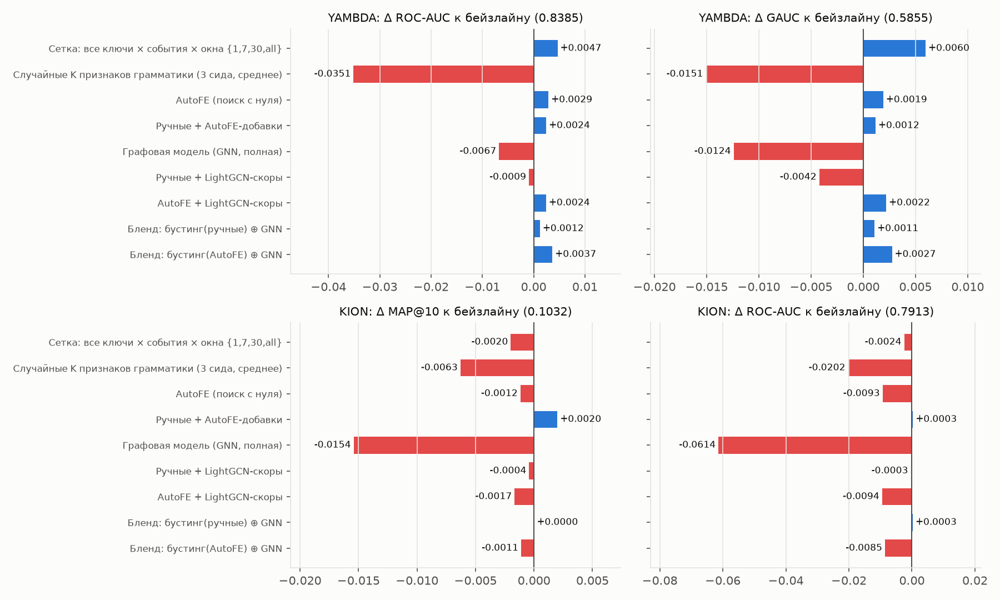
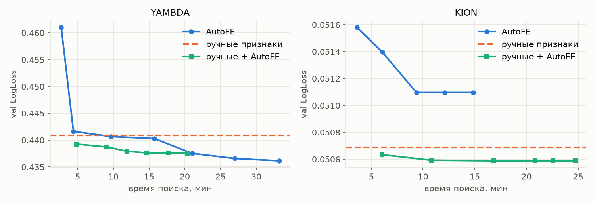
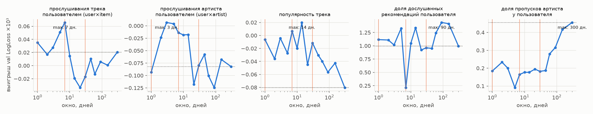
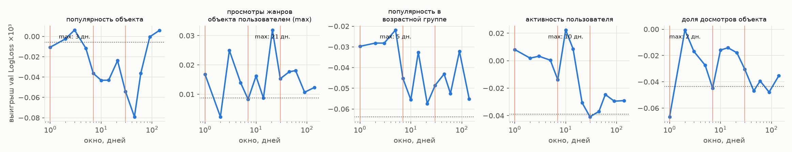
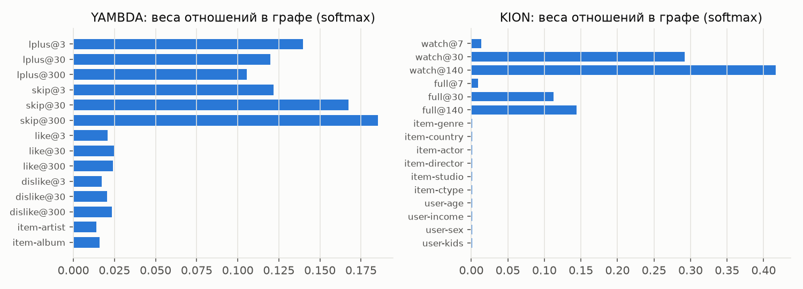

# Ручные признаки, автоматический поиск признаков и графовые модели в ранжировании рекомендаций

Исследование на двух открытых датасетах — **Yambda-50M** (Яндекс Музыка) и **KION** (МТС). Три способа превратить
историю взаимодействий в качество ранжирования сравниваются при одинаковых разбиениях, кандидатах и доступной
информации:

1. **Сильный бейзлайн** — LightGBM на ручных признаках: агрегаты по пользователю, объекту, прямым (user×item) и
   косвенным (user×артист, user×жанр, …) связям.
2. **AutoFE** — эволюционный поиск по грамматике признаков «ключ × тип события × агрегация × окно» с быстрой оценкой
   маржинальной полезности признака (FeatureBoost) и повторной переоценкой кандидатов.
3. **Графовая модель** — гетерогенный граф пользователей, объектов и значений категориальных признаков; рёбра несут
   несколько временных ядер по каждому типу события, и модель сама учит, как их смешивать.

## Главное



* **Поиск по грамматике находит то, что пропустил человек.** На Yambda 52 найденных признака значимо лучше
  57 ручных: LogLoss 0.4325 против 0.4358 (Δ −0.0033, 95 % ДИ [−0.0054; −0.0010]), ROC-AUC 0.8414 против 0.8385.
  На KION 17 найденных признаков дают 99 % MAP@10 ручного набора из 39 (0.1021 против 0.1032), а как добавка к ручным
  6 найденных признаков дают **+0.0020 MAP@10** (0.1052, ДИ [+0.0012; +0.0028]) и +0.0019 NDCG@10.
* **Важен именно поиск, а не только грамматика**: столько же случайных признаков из той же грамматики хуже найденных
  на 0.038 AUC (Yambda) и 0.005 MAP@10 (KION).
* **«Человеческие» окна хороши для счётчиков и плохи для конверсий.** Число прослушиваний трека пользователем лучше
  всего считать ровно за 7 дней, а долю дослушанных рекомендаций — за ~90 дней (ручной набор: 7 и 30), долю пропусков
  артиста — за всю историю.
* **Неожиданный результат**: на Yambda «сетка в лоб» — все ключи × все события × окна {1, 7, 30, all}, 448 признаков —
  лучше и ручных, и AutoFE (LogLoss 0.4304, GAUC +0.0060 к бейзлайну). Ручному набору не хватало покрытия, а отбор
  среди сотен коррелированных признаков LightGBM на 578 k строк делает сам. AutoFE получает ~60 % этого выигрыша
  в 9 раз меньшим числом признаков. На KION та же сетка значимо **хуже** ручных признаков (−0.0020 MAP@10): при 1 %
  позитивов сотни шумных столбцов вредят.
* **Графовая модель без ручных агрегатов почти догоняет бустинг на Yambda** (AUC 0.832 против 0.839), но хуже
  ранжирует внутри дня пользователя (GAUC −0.012) и проигрывает на KION (MAP@10 0.0878 против 0.1032). Бленд
  бустинга на ручных признаках и GNN на Yambda значимо улучшает LogLoss и NDCG@10. Выученные веса отношений интерпретируемы: в музыке для
  распространения важнее всего **пропуски**, в кино — долгая память просмотров, а рёбра «жанр/актёр/демография» модель
  обнуляет сама.
* Самообучаемые LightGCN-эмбеддинги как признаки бустинга не дают ничего ни на одном датасете.

---

## 1. Данные и постановка задач

### Yambda-50M: ответ на рекомендацию

| | |
|---|---|
| Данные | `flat/50m/multi_event.parquet`: 10 000 пользователей с **полной** историей, 47.8 M событий (listen / like / dislike / unlike / undislike), 934 k треков; маппинги трек→артист, трек→альбом. Аудио-эмбеддинги (13.8 ГБ) не используются. |
| Время | `timestamp` — секунды, округлённые до 5 с. В карточке датасета написано «5-second units», но при такой трактовке лог длился бы 1504 «дня» с пятидневной периодичностью; в секундах — 300.9 дня и чёткий суточный цикл. |
| Показ | прослушивание с `is_organic = 0` — трек поставила рекомендательная система (Моя волна, персональные плейлисты). |
| Цель | `label = 1`, если трек дослушан больше чем на 50 % (Listen+ из статьи Yambda), иначе пропуск. Аналог «показ → клик». |
| Строки | первый показ каждой пары (user, item) за день. |
| Момент прогноза | начало дня показа: признаки видят только события до начала этого дня. |
| Разбиение | глобальное по времени: train — дни 289–294 (578 k показов), val — 295–296 (170 k), test — 297–300 (421 k). Доля позитивов ≈ 0.71. |
| Метрики | LogLoss, ROC-AUC (по всем показам), **GAUC** (AUC внутри пары пользователь-день, взвешенный по числу показов) и NDCG@10 внутри пары пользователь-день — насколько хорошо модель переупорядочила бы дневной поток рекомендаций. |

### KION: что пользователь посмотрит на следующей неделе

| | |
|---|---|
| Данные | 5.48 M взаимодействий 962 k пользователей с 15.7 k фильмами и сериалами, демография пользователей, метаданные (жанры, страны, актёры, режиссёры, студии, тип контента). Используется весь лог. |
| Особенность | каждая пара (user, item) встречается **один раз**: `last_watch_dt` — дата последнего просмотра, `total_dur` и `watched_pct` — итоги. Если последний просмотр раньше отсечки, все просмотры пары раньше отсечки, поэтому итоги не несут информации из будущего. |
| Двухэтапная схема | кандидаты: iALS (`implicit`, обучен только на данных до отсечки) top-60 непросмотренных + 60 самых популярных за последние 7 дней, ≈109 кандидатов на пользователя; ранкер оценивает каждого кандидата. |
| Цель | пользователь посмотрел кандидата в течение 7 дней после отсечки. |
| Разбиение | три недели подряд: train — отсечка 2021-08-02, val — 2021-08-09, test — 2021-08-16 (последняя неделя лога). |
| Пользователи | «тёплые» (есть история до отсечки) с хотя бы одним целевым просмотром, выборка с фиксированным сидом: 25 k / 15 k / 30 k пользователей (2.7 M / 1.6 M / 3.3 M строк-кандидатов). Холодным пользователям любой ранкер выдаёт одно и то же популярное, поэтому они не участвуют в сравнении. |
| Полнота кандидатов | ≈ 41 % целевых просмотров попадают в кандидаты (iALS — 23 %, популярное — 29 %). Это потолок Recall для любого ранкера. |
| Метрики | LogLoss, ROC-AUC (по строкам-кандидатам), **MAP@10** (метрика соревнования KION), NDCG@10, Recall@10. Знаменатель — **все** целевые просмотры пользователя, включая не попавшие в кандидаты, то есть метрики сквозные. |

Обе задачи — «пользователь × объект × момент времени → отклик», но разные по природе: в Yambda кандидатов выбрал
логированный рекомендатор и всё решает персональная реакция (много повторного потребления); в KION — поиск нового
контента среди сотни кандидатов (повторов нет по построению).

## 2. Как устроены признаки и почему в них нет утечек

### Грамматика признаков

Любой агрегатный признак записывается одной спецификацией (`src/recfe/features/spec.py`):

```
Spec(key, event, agg, window, value=None, hl=None, red=None)      Ratio(num: Spec, den: Spec)
```

| поле | значения | смысл |
|---|---|---|
| `key` | `user`, `item`, `ui`, `a:<attr>`, `ua:<attr>`, `s:<seg>` | по чему группировать события и как сопоставить группу строке: пользователь; объект; **прямая связь** user×item; популярность атрибута (артист, жанр); **косвенная связь** user×атрибут (сколько пользователь слушал этого артиста, смотрел этот жанр); объект внутри демографического сегмента пользователя |
| `event` | Yambda: `listen, lplus, skip, rec, recplus, recskip, org, like, dislike, unlike`; KION: `watch, full, drop, long` | именованный фильтр событий (`rec*` — показы рекомендатора, `org` — органика; `full` — досмотр ≥ 50 %, `drop` — < 10 %, `long` — ≥ 30 минут) |
| `agg` | `cnt, sum, mean, last, first, dec, nuniq, days` | количество; сумма или среднее значения (доля прослушивания, % просмотра, часы); дней с последнего или первого события; экспоненциально затухающий счётчик с полураспадом `hl`; число различных «партнёров»; число активных дней |
| `window` | дни или `all` | окно `[cutoff − window, cutoff)` |
| `red` | `max, mean, sum, min` | свёртка, когда атрибутов у объекта несколько (у фильма несколько жанров и актёров) |
| `Ratio` | конверсии (skip / listen), доли (user×artist / user), тренды (7 дней / 30 дней) | |

Пример: `R[ua:artist|skip|cnt|w30 / ua:artist|listen|cnt|w30]` — доля пропусков этого артиста у этого пользователя
за 30 дней.

Ручной набор записан **в той же грамматике** (`features/manual.py`) — с «человеческими» окнами 1/7/30/all и
привычными отношениями. Поэтому сравнение «ручные против AutoFE» отвечает ровно на вопрос из задания: кто выбирает
ключи, события, агрегации и окна — инженер или алгоритм. Статические признаки (длина трека; демография, тип
контента, год, возрастной рейтинг; скоры и ранги генераторов кандидатов в KION) общие для всех вариантов ранкера.

### Point-in-time вычисление

`features/engine.py` для каждой отсечки `c` берёт срез лога `ts < c` (лог отсортирован по времени, срез —
zero-copy), применяет фильтры события и окна и делает один `group_by` на все спецификации с общим `(key, event)`.
Ни целевое событие, ни что-либо после отсечки в признак попасть не может по построению. Это проверяет
`tests/test_engine.py`:

* **брутфорс-сверка** — значения признаков всех типов ключей и агрегаций на случайных строках совпадают с наивным
  пересчётом по сырым событиям;
* **тест на утечку** — если удалить из лога все события начиная с отсечки, признаки не меняются ни в одном знаке.

Тест нашёл реальную ошибку на границе окна (в KION события ровно на границе суток выпадали из окна), она исправлена.

Остальные защиты: кандидаты KION и iALS строятся только по данным до отсечки; граф для GNN строится только из
событий до отсечки строки; разбиения глобальные по времени; гиперпараметры, ранняя остановка, отбор признаков и вес
бленда — только по val; test используется один раз в конце.

## 3. Сильный бейзлайн: LightGBM на ручных признаках

LightGBM (binary, lr 0.05, 63 листа, ранняя остановка по val LogLoss), одинаковые параметры для всех наборов признаков.

* **Yambda (57 признаков)** — активность пользователя за 1/7/30 дней, его доля дослушанных рекомендаций, доля
  органики, лайки и дизлайки; популярность и «дослушиваемость» трека, артиста, альбома; прямые связи user×track
  (сколько раз слушал, когда в последний раз, средняя доля прослушивания, лайк/анлайк/дизлайк, сколько раз уже
  рекомендовали и как реагировал); косвенные связи user×artist и user×album (прослушивания за окна, доля пропусков,
  лайки, доля артиста в прослушиваниях пользователя).
* **KION (39 признаков)** — активность, средний % досмотра и давность пользователя; популярность объекта за
  1/7/14/30 дней и всё время, тренд, средний % досмотра, «возраст» объекта; популярность объекта внутри возрастной,
  половой, доходной групп и «с детьми»; популярность жанра, актёра, режиссёра; косвенные связи user×genre (сумма,
  максимум, доля, средний % досмотра, давность), user×actor, user×director, user×country, user×studio, доля типа
  контента.

| Test | Yambda: LogLoss / AUC / GAUC / NDCG@10 | KION: AUC / NDCG@10 / MAP@10 |
|---|---|---|
| эталон без обучения | популярность трека за 7 дней: – / 0.4788 / 0.4966 / 0.7194 | популярность: 0.6695 / 0.1302 / 0.0847; iALS: 0.5634 / 0.0635 / 0.0401 |
| бустинг, только статические признаки | 0.5968 / 0.5509 / 0.5380 / 0.7386 | 0.7580 / 0.1394 / 0.0947 |
| **бустинг, + ручные признаки** | **0.4358 / 0.8385 / 0.5855 / 0.7722** | **0.7913 / 0.1510 / 0.1032** |

Для ориентира: у победителей соревнования KION MAP@10 ≈ 0.12 на закрытой неделе, у популярного — 0.091. Сравнивать
напрямую нельзя: там все пользователи, включая холодных, и другая неделя.

Абляция (test, изменение при удалении одной группы ручных признаков):

| Убрали группу | Yambda: шт. | Δ LogLoss | Δ GAUC | Δ NDCG@10 | KION: шт. | Δ AUC | Δ MAP@10 |
|---|---|---|---|---|---|---|---|
| пользователь | 14 | **+0.0640** | **−0.0216** | −0.0197 | 9 | −0.0032 | −0.0001 |
| объект | 13 | +0.0015 | −0.0038 | +0.0019 | 11 | −0.0069 | −0.0003 |
| user×item (прямые) | 12 | +0.0033 | −0.0113 | **−0.0150** | – | – | – |
| атрибут объекта | 5 | +0.0009 | −0.0024 | +0.0002 | 3 | −0.0016 | −0.0008 |
| user×атрибут (косвенные) | 13 | +0.0017 | −0.0046 | −0.0016 | 11 | **−0.0102** | **−0.0063** |
| сегмент×объект | – | – | – | – | 5 | −0.0011 | −0.0004 |

В музыке почти всё решает пользователь (кто-то пропускает половину рекомендаций, кто-то дослушивает всё) и прямая
история с треком; внутри дня пользователя — прямые связи. В кино — косвенные связи user×жанр/актёр/страна: повторов
нет, и вкус переносится только через атрибуты.

## 4. Идея 1: AutoFE — поиск по грамматике признаков

`autofe/generate.py`, `autofe/search.py`. Цикл одного поколения:

1. **Генерация.** Поколение 0 — 160 случайных спецификаций (окна log-равномерно от 1 дня до всей истории, ~25 % —
   отношения). Далее по 60: мутации лучших найденных признаков (окно ×/÷ e^N(0, 0.6), смена агрегации, события,
   ключа на «соседний» — user↔user×artist, item↔artist/album↔segment×item, свёртки), композиция в отношения
   (конверсия, доля, тренд) и 25 % случайных для исследования.
2. **Вычисление** на train и val тем же point-in-time движком; результаты кэшируются на диск по имени признака.
3. **Быстрая оценка — FeatureBoost** (идея OpenFE, Zhang et al., ICML 2023): для каждого кандидата обучается маленький
   бустинг (40 деревьев, 15 листьев) **на одном этом признаке**, стартующий с предсказаний текущей модели
   (`init_score`) на train; полезность — падение LogLoss на val. Это маржинальная ценность признака при уже выбранных,
   за цену модели на одном столбце (< 1 с на 700 k строк).
4. **Переоценка.** 40 лучших ещё не выбранных кандидатов прошлых поколений каждый раз оцениваются заново
   относительно текущей модели: их старая полезность измерена до того, как приняли последнюю пачку.
5. **Отбор.** До 8 лучших кандидатов, не дублирующих выбранные (|corr| < 0.97), добавляются пачкой; полная модель
   переобучается, и пачка принимается, только если val LogLoss улучшился (иначе пробуется половина пачки).
   Предсказания новой модели становятся `init_score` следующего поколения. Стоп — 3 поколения без улучшений.

Переоценка (п. 4) появилась после первой версии поиска. Без неё на KION поиск застревал на 11–14 признаках
(val LogLoss 0.0515): мутации уже выбранных признаков оказывались избыточными, а хорошие кандидаты нулевого поколения
так и не переоценивались после первой принятой пачки. С переоценкой — 17 признаков и 0.0511. Логи обеих версий лежат
в `reports/results/*__autofe_v1_search.json` и `*__autofe_search.json`.

Контрольные эксперименты:

* **Сетка** — все ключи × события × окна {1, 7, 30, all} + давность + средние значения целиком в LightGBM
  (Yambda — 448 признаков; KION — 216, только события `watch` и `full`, чтобы 2.7 M строк поместились в 16 ГБ);
* **Случайные K** — столько же случайных признаков грамматики (из пула нулевого поколения), сколько нашёл AutoFE,
  3 сида;
* **Ручные + AutoFE** — тот же поиск, но стартующий с ручного набора: что можно к нему добавить;
* **Анализ окон** — для нескольких шаблонов окно пробегает сетку от 1 до 300 дней, ценность меряется тем же
  FeatureBoost относительно ручной модели без этого семейства признаков.



### Что нашёл поиск

**Yambda** — 52 признака за 7 поколений (520 кандидатов). Самые полезные (порядок отбора):

1. `user|lplus|mean(played)|w110` — средняя доля прослушивания дослушанных треков за 110 дней;
2. `R[ua:album|recplus|cnt|w265 / ua:album|rec|cnt|w265]` — как пользователь реагирует на рекомендации из этого альбома за 265 дней;
3. `R[ua:album|skip|cnt|w119 / ua:album|listen|cnt|w119]`, `R[ui|skip|cnt|w89 / ui|listen|cnt|w89]`,
   `R[ui|recskip|cnt|w204 / ui|rec|cnt|w204]` — доли пропусков на уровне альбома и самого трека за длинные окна;
4. `user|recskip|mean(played)|w6` — **как глубоко пользователь доходит в треке, прежде чем пропустить рекомендацию**,
   за последние 6 дней («скорость пропуска» — такого признака в ручном наборе нет);
5. `user|recskip|dec(h10.1)|w1`, `user|recplus|dec(h10.1)|w1` — затухающие счётчики вчерашних пропусков и
   дослушиваний: состояние пользователя накануне.

В целом поиск предпочёл **конверсии и средние доли прослушивания вместо счётчиков**, **длинные окна (90–265 дней)
для долей** и **очень короткие (1 день, полураспад ~10 часов) — для «состояния»**. Ручной набор считал доли за
7–30 дней и не использовал долю прослушивания внутри пропусков.

**KION** — 17 признаков за 5 поколений: в основном косвенные связи с «качественными» событиями и короткими окнами —
`ua:actor|long|cnt|w20|mean` (сколько раз за 20 дней пользователь смотрел ≥ 30 минут фильмы с этими актёрами),
`ua:genre|full|cnt|w4|mean`, `ua:country|full|sum(hours)|w7|mean`, `ua:ctype|watch|cnt|w7`, а также **доли «брошенных»
просмотров** жанра и демографических сегментов (`a:genre|drop|cnt|w5|max`, `R[s:age|drop|cnt|w120 / s:age|watch|cnt|w120]`).
Добавки к ручному набору — те же идеи: брошенные просмотры жанра за 5–7 дней, долгие просмотры с актёрами за 20–61 день.

### Окна: почему 7 дней, а не 10




Оранжевые линии — окна 1/7/30 дней, точечная — вся история. Ось Y — выигрыш val LogLoss (×10³) от добавления
одного признака к ручной модели без его семейства.

| Шаблон | лучшее окно | выигрыш ×10³ | лучшее из {1, 7, 30, all} | выигрыш ×10³ |
|---|---|---|---|---|
| Yambda: прослушивания трека пользователем | 7 | 0.066 | 7 | 0.066 |
| Yambda: доля дослушанных рекомендаций пользователя | **90** | **1.44** | 1 | 1.12 |
| Yambda: доля пропусков артиста у пользователя | **все 300** | **0.46** | all | 0.46 (30 дней — 0.18) |
| Yambda: прослушивания артиста / популярность трека | 3 / 14 | ≤ 0.02 | – | шум |
| KION: все пять шаблонов | – | ≤ 0.03 | – | шум |

Для счётчиков «человеческие» окна оказались правильными. Для конверсий оптимальное окно на порядок длиннее: долю
нужно оценивать по большому числу событий, иначе она шумная. Окно 7 дней для доли дослушанных рекомендаций — худшее
во всей сетке. На KION при наличии остальных признаков выбор окна вообще не влияет на качество — уровень шума
FeatureBoost здесь порядка ±3·10⁻⁵.

## 5. Идея 2: графовая модель

`graph/build.py`, `graph/model.py`, `graph/train.py`.

**Граф на момент отсечки** (только события до неё). Вершины: пользователи, объекты, значения атрибутов (артист,
альбом / жанр, страна, актёр, режиссёр, студия, тип) и значения сегментов пользователя (возраст, доход, пол, дети).
Рёбра user–item несут вектор весов по **отношениям** «тип события × временной масштаб»: `w = Σ exp(−возраст/τ)`.
Yambda: listen+, skip, like, dislike × τ ∈ {3, 30, 300} дней — 12 отношений; KION: watch, full × τ ∈ {7, 30, 140} —
6 отношений. Статические рёбра item–атрибут и user–сегмент — отдельные отношения. Каждое отношение симметрично
нормировано отдельно.

**Модель.** LightGCN-подобное распространение (2 слоя, d = 64) по матрице `A = Σ_r softmax(α)_r · Â_r`, где веса
отношений `α` обучаются. Это дифференцируемый аналог поиска окна: вместо выбора «7 или 10 дней» модель смешивает
короткую, среднюю и длинную память, позитивные и негативные события. Голова — MLP над
`[e_u, e_i, e_u⊙e_i, e_u⊙e_artist, e_u⊙e_album]` плюс общие графовые величины без ручного дизайна (логарифм взвешенной
степени вершины по каждому отношению, веса самого ребра (user, item), если оно есть) и те же статические признаки,
что у бустинга. Потеря — BCE на тех же строках train + 0.1·BPR (предсказание рёбер). Параметры обучаются на
train-отсечках (граф строки — на её отсечке) и применяются к val/test распространением по более свежему графу.

Градиент по весам отношений требует скалярного произведения на каждое ненулевое значение матрицы (≈ 26 M для
Yambda) — в 20 раз дороже самого spmm. В `MixSpMM` он оценивается несмещённо по случайным 2 M ненулевым; шаг обучения
по всему графу Yambda — меньше секунды на RTX 3070 Laptop.

**Как модель доводилась.** Первая версия (lr 2e-3, проверка val раз в эпоху) достигала лучшего качества после первой
эпохи, а дальше переобучалась: val LogLoss 0.453 → 0.467 → 0.512. Свободные эмбеддинги 1.5 M вершин (95 M параметров)
запоминают пользователей из train-дней. Итоговая версия: dropout 0.2 на эмбеддингах, L2 на эмбеддингах батча, lr 1e-3,
проверка val после каждого train-дня (KION — каждой четверти строк). Отдельный lr для весов отношений нужен, иначе они
не отходят от равномерных. Test LogLoss на Yambda: 0.4507 → 0.4439.

Варианты: **GNN** (полная); **GNN, только эмбеддинги** (без степеней, весов рёбер и статики — чистое представление);
**LightGCN-BPR** — обучен только предсказывать рёбра графа до первой train-отсечки, меток не видел, его скоры
`e_u·e_i`, `e_u·e_artist` добавляются бустингу признаками; **бленд** бустинга и GNN по логитам, вес по val.



## 6. Сравнение

Все модели — на одних и тех же строках test (одинаковые кандидаты, отсечки и доступная информация). В столбце
«признаков» учтены статические.

### Yambda (test)

| Модель | LogLoss | AUC | GAUC | NDCG@10 | признаков |
|---|---|---|---|---|---|
| Только статические признаки | 0.5968 | 0.5509 | 0.5380 | 0.7386 | 1 |
| **Бустинг на ручных признаках (бейзлайн)** | 0.4358 | 0.8385 | 0.5855 | 0.7722 | 58 |
| Сетка: все ключи × события × окна {1,7,30,all} | **0.4304** | **0.8432** | **0.5915** | **0.7774** | 449 |
| Случайные K признаков грамматики (3 сида) | 0.4707 | 0.8034 | 0.5705 | 0.7614 | 53 |
| **AutoFE** (поиск с нуля) | 0.4325 | 0.8414 | 0.5874 | 0.7718 | 53 |
| Ручные + AutoFE-добавки | 0.4332 | 0.8410 | 0.5867 | 0.7755 | 82 |
| **Графовая модель** (GNN) | 0.4439 | 0.8318 | 0.5731 | 0.7698 | – |
| GNN, только эмбеддинги | 0.4908 | 0.7882 | 0.5292 | 0.7350 | – |
| Статические + LightGCN-скоры | 0.5884 | 0.5916 | 0.5223 | 0.7335 | 4 |
| Ручные + LightGCN-скоры | 0.4367 | 0.8376 | 0.5813 | 0.7716 | 61 |
| AutoFE + LightGCN-скоры | 0.4330 | 0.8409 | 0.5877 | 0.7706 | 56 |
| Бленд: бустинг(ручные) ⊕ GNN | 0.4343 | 0.8397 | 0.5866 | 0.7740 | – |
| Бленд: бустинг(AutoFE) ⊕ GNN | 0.4316 | 0.8422 | 0.5883 | 0.7734 | – |

### KION (test)

| Модель | LogLoss | AUC | NDCG@10 | Recall@10 | MAP@10 | признаков |
|---|---|---|---|---|---|---|
| Только статические признаки (+ скоры кандидатов) | 0.0521 | 0.7580 | 0.1394 | 0.2116 | 0.0947 | 13 |
| **Бустинг на ручных признаках (бейзлайн)** | 0.0507 | 0.7913 | 0.1510 | 0.2266 | 0.1032 | 52 |
| Сетка: все ключи × события × окна {1,7,30,all} | 0.0508 | 0.7889 | 0.1494 | 0.2264 | 0.1012 | 229 |
| Случайные K признаков грамматики (3 сида) | 0.0516 | 0.7711 | 0.1423 | 0.2149 | 0.0969 | 30 |
| **AutoFE** (поиск с нуля) | 0.0510 | 0.7821 | 0.1494 | 0.2248 | 0.1021 | 30 |
| Ручные + AutoFE-добавки | **0.0506** | **0.7917** | **0.1529** | **0.2274** | **0.1052** | 58 |
| **Графовая модель** (GNN) | 0.0531 | 0.7300 | 0.1292 | 0.1964 | 0.0878 | – |
| GNN, только эмбеддинги | 0.0626 | 0.5786 | 0.0463 | 0.0941 | 0.0233 | – |
| Статические + LightGCN-скоры | 0.0521 | 0.7574 | 0.1389 | 0.2106 | 0.0944 | 15 |
| Ручные + LightGCN-скоры | 0.0507 | 0.7910 | 0.1507 | 0.2273 | 0.1028 | 54 |
| AutoFE + LightGCN-скоры | 0.0511 | 0.7819 | 0.1485 | 0.2233 | 0.1016 | 32 |
| Бленд: бустинг(ручные) ⊕ GNN | 0.0507 | 0.7916 | 0.1510 | 0.2267 | 0.1032 | – |
| Бленд: бустинг(AutoFE) ⊕ GNN | 0.0510 | 0.7828 | 0.1495 | 0.2251 | 0.1021 | – |

Те же таблицы на val, все абляции и списки найденных признаков — в [`reports/tables.md`](reports/tables.md).

### Значимость

Парный бутстрэп по группам (Yambda — пользователь-день, KION — пользователь; 1000 повторов): обе модели оцениваются
на одной и той же выборке групп, интервал — для разности с бейзлайном. ✱ — 95 % интервал не содержит ноль.

| Yambda, модель − бейзлайн | Δ LogLoss | Δ GAUC | Δ NDCG@10 |
|---|---|---|---|
| Сетка | −0.0054 [−0.0071; −0.0035] ✱ | +0.0060 [+0.0025; +0.0095] ✱ | +0.0052 [+0.0031; +0.0073] ✱ |
| AutoFE | −0.0033 [−0.0054; −0.0010] ✱ | +0.0019 [−0.0014; +0.0051] | −0.0004 [−0.0027; +0.0017] |
| Ручные + AutoFE | −0.0026 [−0.0038; −0.0013] ✱ | +0.0012 [−0.0016; +0.0038] | +0.0033 [+0.0014; +0.0051] ✱ |
| GNN | +0.0081 [+0.0057; +0.0106] ✱ | −0.0124 [−0.0170; −0.0077] ✱ | −0.0024 [−0.0049; +0.0001] |
| Бленд ручные ⊕ GNN | −0.0015 [−0.0023; −0.0006] ✱ | +0.0011 [−0.0014; +0.0034] | +0.0018 [+0.0005; +0.0031] ✱ |
| Бленд AutoFE ⊕ GNN | −0.0043 [−0.0062; −0.0021] ✱ | +0.0027 [−0.0006; +0.0059] | +0.0011 [−0.0011; +0.0031] |

| KION, модель − бейзлайн | Δ LogLoss | Δ MAP@10 | Δ NDCG@10 |
|---|---|---|---|
| Сетка | +0.00013 [+0.00009; +0.00018] ✱ | −0.0020 [−0.0031; −0.0008] ✱ | −0.0016 [−0.0027; −0.0006] ✱ |
| AutoFE | +0.00034 [+0.00028; +0.00040] ✱ | −0.0012 [−0.0023; +0.0000] | −0.0016 [−0.0028; −0.0004] ✱ |
| Ручные + AutoFE | −0.00008 [−0.00011; −0.00006] ✱ | +0.0020 [+0.0012; +0.0028] ✱ | +0.0019 [+0.0010; +0.0027] ✱ |
| GNN | +0.0024 [+0.0023; +0.0025] ✱ | −0.0154 [−0.0172; −0.0138] ✱ | −0.0218 [−0.0235; −0.0202] ✱ |
| Бленд ручные ⊕ GNN | −0.00002 [−0.00003; −0.00002] ✱ | +0.0000 [−0.0003; +0.0003] | +0.0000 [−0.0003; +0.0004] |

Интервалы учитывают разброс выборки test, но не случайность обучения. Её порядок виден по контролю «случайные K»:
на KION MAP@10 трёх сидов — 0.094, 0.101 и 0.096.

### Вычислительные затраты и масштабируемость

Ноутбук: Intel i7-12700H (20 потоков), 16 ГБ RAM, RTX 3070 Laptop (8 ГБ).

| Датасет | Подход | Признаки / графы | Обучение | Инференс test | Железо |
|---|---|---|---|---|---|
| Yambda | бустинг, ручные (58) | 2.9 мин | 8 с | 0.8 с | CPU |
| Yambda | бустинг, AutoFE-набор (53) | 4.3 мин | 9 с | 1.1 с | CPU |
| Yambda | бустинг, сетка (449) | 12.2 мин | 51 с | 1.2 с | CPU |
| Yambda | поиск AutoFE: 7 поколений, 520 кандидатов | 19 мин | скрининг 10 мин + переобучения 4 мин (всего 33 мин) | – | CPU |
| Yambda | GNN (95 M параметров) | 13 мин (12 отсечек) | 1.1 мин | 1.1 мин (val + test) | GPU, пик 6.2 ГБ |
| KION | бустинг, ручные (52) | 0.6 мин | 34 с | 7.8 с | CPU |
| KION | бустинг, AutoFE-набор (30) | 0.7 мин | 38 с | 11.8 с | CPU |
| KION | бустинг, сетка (229) | 0.6 мин | 139 с | 11.1 с | CPU |
| KION | поиск AutoFE: 5 поколений, 400 кандидатов | 3 мин | скрининг 9 мин + переобучения 3 мин (всего 15 мин) | – | CPU |
| KION | GNN (70 M параметров) | 1 мин (3 отсечки) | 1.7 мин | 0.9 мин (val + test) | GPU, пик 4.7 ГБ |

Время признаков — суммарное point-in-time вычисление на train + val + test. Во времени поиска признаки нулевого и
первого поколений взяты из кэша первой версии поиска; с холодным кэшем это ещё ~10 мин (Yambda) и ~4 мин (KION).

* **Движок признаков.** Стоимость ∝ число отсечек × число пар (ключ, событие) × размер среза истории. На
  47.8 M событий одна пара (ключ, событие) на одну отсечку — 0.5–1 с. Для логов в миллиарды событий нужно хранить
  дневные частичные агрегаты по ключам: окно любой длины — сумма частичных (префиксные суммы), затухающий счётчик
  обновляется за O(1) (`S ← S·e^(−Δ/τ) + x`). Признак с «нечеловеческим» окном 110 дней стоит столько же, сколько
  с окном 30.
* **AutoFE** упирается в вычисление кандидатов (~60 % времени на Yambda), скрининг линейный по строкам и дешёвый.
  Масштабируется сэмплированием пользователей для поиска (нужен только порядок кандидатов, а не точные значения) и
  successive halving по строкам. Найденный набор потом считается на полных данных так же, как ручной.
* **GNN** распространяет эмбеддинги по всему графу на каждом шаге: память O(вершины·d + рёбра·отношения).
  Yambda-50M — 1.5 M вершин, 13 M пар user–item × 14 отношений, 6.2 ГБ GPU, граф на одну отсечку — ~1 мин CPU и
  670 МБ на диске. Для Yambda-5B (9.4 M треков, ~миллиард пар) нужна выборка соседей (GraphSAGE / ClusterGCN),
  предвычисленное распространение (SIGN) или жёсткое прореживание старых рёбер. Бустинг на агрегатах масштабируется
  проще.

## 7. Анализ

### Что сработало

1. **Грамматика + поиск находят сигналы, которых нет в ручном наборе.** На Yambda это конверсии и доли
   прослушивания с длинными окнами плюс «вчерашнее состояние» пользователя; на KION — брошенные просмотры жанров и
   сегментов, долгие просмотры с теми же актёрами за последние недели. AutoFE с нуля на Yambda значимо лучше ручного
   набора по LogLoss и AUC при меньшем числе признаков. На KION добавки к ручному набору дают значимые +2 % MAP@10.
2. **Поиск важнее грамматики**: случайные признаки той же грамматики и того же числа заметно хуже на обоих
   датасетах. Без отбора грамматика бесполезна.
3. **Окна.** Для счётчиков выбор человека подтвердился (7 дней — оптимум), для конверсий — нет: оптимум 90–300 дней.
   Это ровно тот случай из постановки задачи: «почему именно семь» — потому что для долей это плохое окно.
4. **Бленд с GNN на Yambda** даёт значимый выигрыш по LogLoss и NDCG@10: граф ловит часть сигнала, которой нет в
   агрегатах.

### Что не сработало и почему

1. **На Yambda «сетка» лучше умного поиска.** 448 коррелированных признаков на 578 k строк с сильным сигналом —
   комфортный режим для LightGBM, он отбирает сам. Узким местом ручного набора было покрытие, а не отбор. AutoFE
   получил ~60 % выигрыша сетки (по LogLoss: 0.0033 из 0.0054) в 9 раз меньшим числом признаков, что важно для
   памяти, инференса и поддержки. Но для чистого качества здесь достаточно «перебора в лоб». Кроме того, поиск с нуля
   на Yambda был прерван после 7 поколений (см. ограничения) и ещё улучшался, так что его результат — нижняя оценка.
2. **На KION сетка значимо хуже ручных признаков**: при 1 % позитивов и сильных скорах кандидатов сотни шумных
   столбцов приводят к переобучению. «Кидать всё в бустинг» — не универсальный рецепт.
3. **Шум при приёмке.** На KION разница val LogLoss от пачки признаков (~10⁻⁴) сравнима с разбросом самого LightGBM
   при другом наборе столбцов. Пачки с полезностью при скрининге 1.6·10⁻⁴ отклонялись, и поиск с нуля остановился на
   17 признаках, немного хуже ручных. Лечится приёмкой по нескольким сидам или фолдам либо по ранжирующей метрике.
4. **Графовая модель уступает бустингу**, хотя видит ту же информацию:
   * свободные ID-эмбеддинги быстро переобучаются: лучший val — внутри первой эпохи на Yambda и второй на KION;
   * MLP-голова хуже бустинга использует табличные входы: на KION val AUC 0.741 против 0.758 у бустинга на тех же
     статических признаках;
   * на KION сигнал — динамика популярности и скоры кандидатов, а распространение по графу с памятью 30–140 дней
     «что популярно на этой неделе» не ловит;
   * чистые эмбеддинги без степеней и весов рёбер слабы (Yambda AUC 0.788, KION 0.579): качество полной GNN в основном
     дают общие графовые величины — по сути те же агрегаты на трёх фиксированных масштабах времени.

   При этом выученные веса отношений содержательны. На Yambda **пропуски весят больше дослушиваний**, лайки и
   дизлайки — по ~0.02, то есть неявный негатив — сильнейший сигнал для распространения. На KION доминирует память на
   140 и 30 дней, недельное отношение и **все статические рёбра** (жанр, актёр, демография) получили ~0: модель сама
   отказалась сглаживать вкус по атрибутам. Бустингу косвенные связи нужны как агрегаты, а не как сглаживание.
5. **LightGCN-скоры как признаки бустинга бесполезны** на обоих датасетах. Восстановление прошлых рёбер не
   совпадает с целью (пропуск, новый просмотр), а информация о связи уже есть в прямых и косвенных агрегатах.

### Ограничения

* Одно временное разбиение на датасет и один сид обучения для основных моделей. Бутстрэп учитывает разброс test, но
  не случайность обучения.
* KION: выборка пользователей (25 k / 15 k / 30 k), полнота кандидатов 41 % ограничивает все метрики сверху.
* Yambda: признаки на начало дня — без внутридневного контекста сессии, а он в музыке очень важен. Это следующее
  естественное направление (модели над историей событий, пункт 3 задания).
* Val использовался и для скрининга, и для приёмки — оценка на val оптимистична. Test подтверждает большую часть
  выигрыша: AutoFE на Yambda — Δ LogLoss −0.0048 на val, −0.0033 на test.
* Поиск с нуля оба раза прервался из-за падения `lib_lightgbm.dll`: параллельные обучения LightGBM в потоках Python
  на Windows иногда падают с access violation. Скрининг переписан на последовательный, но эти два запуска оценены по
  сохранённому отбору: Yambda — после 7 поколений (ещё улучшался), KION — после 5 (два последних без улучшений,
  то есть сошёлся). Поиски «ручные + AutoFE» прошли до конца с исправленным кодом.
* Гиперпараметры GNN почти не подбирались: d, число слоёв и сетка τ фиксированы, нет выборки соседей.

### Что делать дальше

* AutoFE: приёмка по нескольким сидам или фолдам, многокритериальный поиск (качество против стоимости признака),
  поиск поверх сетки (отбор из 448 вместо генерации с нуля).
* Граф: индуктивные входы вместо ID-эмбеддингов, временная GNN (кодирование времени событий, TGN-подобная память),
  сессионная модель для музыки.

## 8. Воспроизведение

```powershell
# окружение; на Windows venv должен лежать по короткому пути, иначе pip и torch упираются в лимит 260 символов
py -3.12 -m venv C:\venvs\recfe
C:\venvs\recfe\Scripts\python -m pip install -r requirements.txt --extra-index-url https://download.pytorch.org/whl/cu126
C:\venvs\recfe\Scripts\python -m pip install --no-deps -e .

# весь пайплайн: загрузка данных → подготовка → строки → тесты → эксперименты → отчёт (~3–4 ч на ноутбуке выше)
.\run_all.ps1 -Py C:\venvs\recfe\Scripts\python.exe
```

Шаги по отдельности (из корня проекта; на Linux/macOS — те же команды через `python -m`):

| Шаг | Команда |
|---|---|
| данные (~560 МБ) | `python -m recfe.data.download` |
| единый формат событий | `python -m recfe.data.prepare_yambda`, `python -m recfe.data.prepare_kion` |
| строки и кандидаты | `python -m recfe.tasks.yambda`, `python -m recfe.tasks.kion` |
| тесты движка (сверка + утечки) | `python tests/test_engine.py` |
| бейзлайн + абляции | `python -m recfe.experiments.baseline <ds>` |
| AutoFE | `python -m recfe.experiments.autofe_run <ds> autofe` и `... <ds> manual_autofe` |
| контроли | `python -m recfe.experiments.controls <ds> random`, `... <ds> grid`, `python -m recfe.experiments.window_sweep <ds>` |
| графовые модели | `python -m recfe.graph.train <ds> gnn` (`gnn_emb`, `lgcn_bpr`) |
| гибриды, значимость | `python -m recfe.experiments.hybrid <ds>`, `python -m recfe.experiments.significance <ds>` |
| таблицы и графики | `python -m recfe.experiments.report` |

`<ds>` — `yambda` или `kion`. Все результаты — JSON в `reports/results/`, графики — в `reports/figures/`, логи —
в `reports/logs/`. Найденные признаки любого поиска: `python scripts/inspect_search.py reports/results/yambda__autofe_search.json`.
Если поиск прервался, его сохранённый отбор оценивается командой `python -m recfe.experiments.autofe_run <ds> autofe finalize`.

### Структура

```
src/recfe/
  data/           загрузка и приведение обоих датасетов к единому логу событий
  tasks/          постановка задач: строки, отсечки, кандидаты (iALS + популярное), разбиения
  features/       грамматика (spec), point-in-time движок (engine), кэш (store), ручной набор (manual)
  autofe/         генерация и мутации (generate), поиск с FeatureBoost (search)
  graph/          построение графа (build), модель и MixSpMM (model), обучение и инференс (train)
  models/gbdt.py  LightGBM
  metrics.py      LogLoss, AUC, GAUC, NDCG/Recall/MAP@K
  experiments/    бейзлайн, AutoFE, контроли, окна, гибриды, значимость, отчёт
tests/            сверка движка с брутфорсом и тест на утечку
reports/          таблицы, графики, JSON-результаты, логи
```
